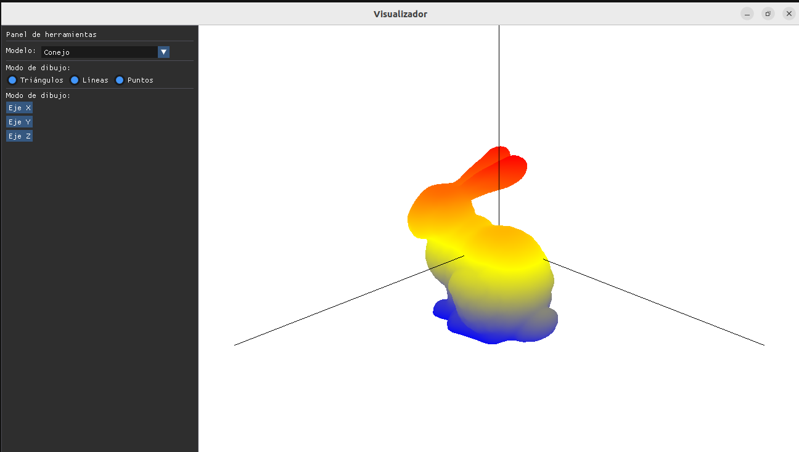
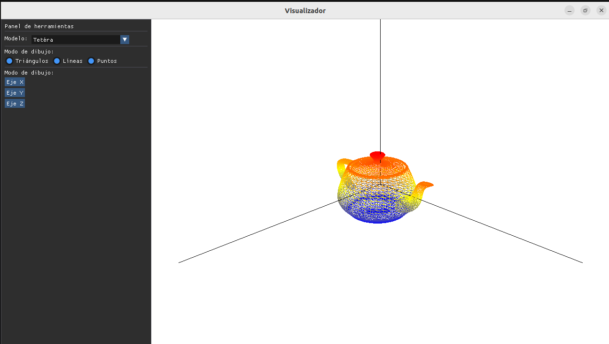
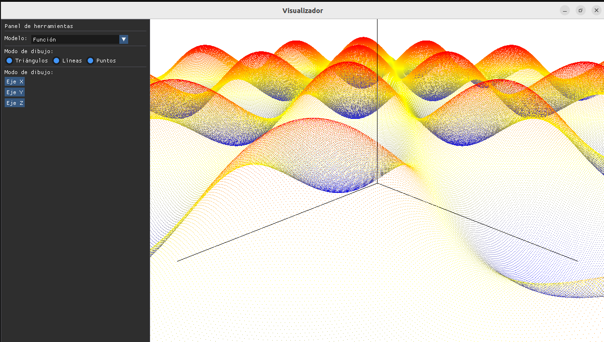

# Proyecto_Visualizacion_20271

Repositorio de proyectos para la materia de Visualización.

Visualizador 3D en OpenGL que carga modelos `.obj`, los muestra como superficie, líneas o puntos, dibuja un eje coordenado en el origen y permite rotar el modelo desde una interfaz hecha con Dear ImGui.

---

## Dependencias

- Compilador con soporte de C++17
- CMake
- GLFW, GLEW y GLM
- Dear ImGui (incluida en `libs/`)

Instalación en Ubuntu/Debian:

```bash
sudo apt install build-essential cmake libglfw3-dev libglew-dev libglm-dev
```

---

## Compilar y ejecutar

Compilar:

```bash
cmake -B build
cmake --build build
```

Ejecutar (desde la raíz del proyecto, para que encuentre las carpetas `shaders/` y `obj/`):

```bash
./build/visualizador
```

---

## Cómo utilizar el programa

Al iniciar se muestra el conejo junto con los ejes coordenados (X, Y, Z) dibujados en negro. El panel de herramientas está a la izquierda de la ventana.

### Panel de herramientas

| Sección | Control | Descripción |
|---|---|---|
| Modelo | Lista desplegable | Selecciona el modelo a mostrar: Conejo, Carro, Casa, Gato, Pescado o Tetera. |
| Modo de dibujo | Triángulos | Dibuja la superficie del modelo (`GL_TRIANGLES`). |
| Modo de dibujo | Líneas | Dibuja las aristas de la malla (`GL_LINES`). |
| Modo de dibujo | Puntos | Dibuja la nube de vértices (`GL_POINTS`). |
| Rotación | Botón **Eje X** | Rota el modelo sobre el eje X. |
| Rotación | Botón **Eje Y** | Rota el modelo sobre el eje Y. |
| Rotación | Botón **Eje Z** | Rota el modelo sobre el eje Z. |

### Cámara y teclado

| Entrada | Acción |
|---|---|
| Clic izquierdo + arrastrar | Mueve la cámara orbital alrededor del modelo. |
| `Enter` | Reinicia la cámara a su posición inicial. |
| `Esc` | Cierra el programa. |

> El clic sobre el panel de herramientas no mueve la cámara.

---

## Estructura del proyecto

```
.
├── CMakeLists.txt
├── README.md
├── imgs/                          # Capturas del visualizador
├── include/                       # Archivos de cabecera (.h)
│   ├── Model.h                    # Clase base de los modelos
│   ├── ModelImporter.h
│   ├── OrbitCamera.h
│   ├── Scene.h
│   ├── ShaderProgram.h
│   ├── WindowGL.h
│   └── models/
│       ├── Axes.h                 # Eje coordenado (GL_LINES)
│       ├── Grid.h                 # Malla de referencia
│       └── ImportedModel.h        # Modelos cargados desde .obj
├── libs/                          # Librerías externas (Dear ImGui)
├── obj/                           # Modelos .obj
├── shaders/                       # Shaders GLSL (modelos y ejes)
└── src/                           # Implementaciones (.cpp)
    ├── main.cpp
    ├── ModelImporter.cpp          # Lectura de archivos .obj
    ├── OrbitCamera.cpp            # Cámara orbital
    ├── Scene.cpp                  # Ventana, interfaz y ciclo de render
    ├── ShaderProgram.cpp          # Compilación de shaders
    ├── WindowGL.cpp
    └── models/
        ├── Axes.cpp
        ├── Grid.cpp
        └── ImportedModel.cpp
```

---

## Imágenes del visualizador

### Interfaz y modelo en modo triángulos


### Modo líneas


### Modo puntos
